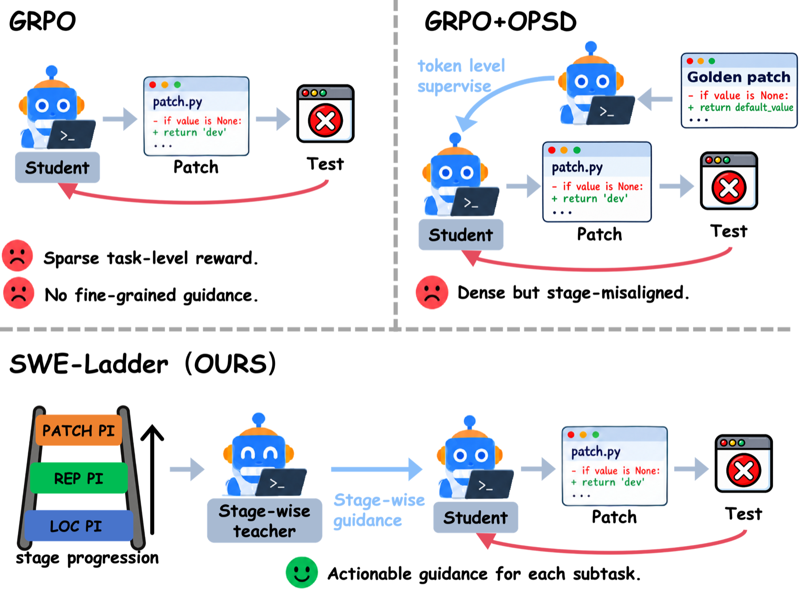
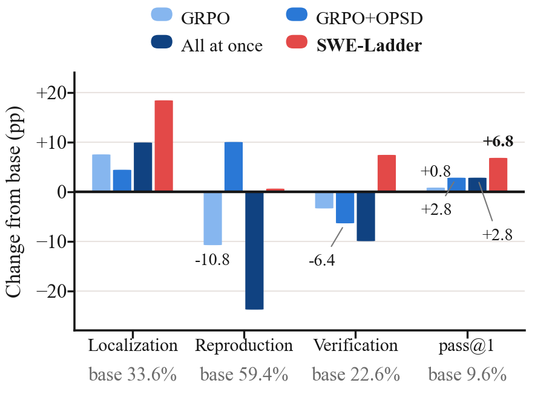
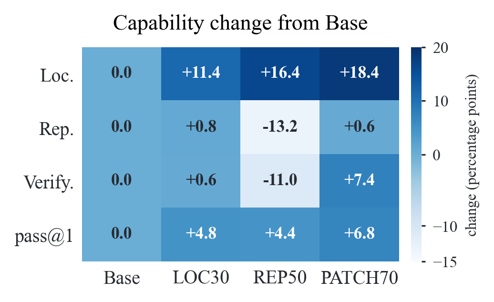

<div align="center">

# SWE-Ladder

**Learning to Localize, Reproduce, and Patch via<br/>Progressive Privileged Self-Distillation**

[](https://anonymous.4open.science/r/SWE-Ladder-279F/)
[](LICENSE)
[](pyproject.toml)

</div>

<p align="center">
  
</p>

<p align="center"><em>
A rule-based router labels each step of an end-to-end rollout as LOC, REP, or PATCH. In each phase, a frozen teacher receives only that stage's evidence and distills only that stage's tokens, while GRPO continues to optimize the full trajectory.
</em></p>

Resolving a repository-level issue requires a software-engineering agent to
localize the faulty code, reproduce the failure, and patch the code.
Reinforcement learning with verifiable rewards supplies one signal for the final
patch; on-policy self-distillation (OPSD) supplies denser token-level guidance,
but a teacher shown the full reference patch at every step gives the same
evidence at every stage. **SWE-Ladder** turns each verified repair into three
stage-specific evidence views and distills them in repair order, training a
single end-to-end agent without privileged evidence at inference time.

## News

- **Oct 2026** — Code released alongside the ACL 2027 submission.

## Highlights

- **Stage-specific privilege instead of whole-answer privilege.** The teacher sees
  changed files and line ranges for localization, fail-to-pass tests for
  reproduction, and the reference diff for patching — never the whole answer at
  every step.
- **Progressive supervision in repair order.** Distillation moves
  `LOC → REP → PATCH` over 30 + 20 + 20 training iterations while GRPO keeps
  optimizing every valid response token.
- **A single inference-time policy.** No teacher, no stage labels, no fixed
  pipeline at test time.
- **+6.8 points on R2E-Gym and +4.6 points on OpenHands** on SWE-bench
  Verified, without task-specific supervised fine-tuning before RL.

## Results

All numbers are single-seed runs from the Qwen3-4B-Instruct-2507 base
checkpoint, with no task-specific supervised fine-tuning before RL, evaluated on
the 500 instances of SWE-bench Verified. `pass@1` is the official verifier
result; `env_done` is the fraction of rollouts that terminated on their own.

| Scaffold | Method | pass@1 (%) | Avg. steps | env_done (%) |
|---|---|---:|---:|---:|
| **R2E-Gym** | Qwen3-4B-Instruct-2507 (Base) | 9.6 | 26.5 | 84.2 |
| | GRPO | 10.4 | 82.9 | 36.0 |
| | GRPO+OPSD (full patch) | 12.4 | 39.7 | 67.4 |
| | SDAR | 4.6 | 34.5 | 88.0 |
| | **SWE-Ladder** | **16.4** | **19.3** | **98.6** |
| **OpenHands** | Qwen3-4B-Instruct-2507 (Base) | 13.0 | 40.8 | 79.2 |
| | GRPO | 11.2 | 56.2 | 78.6 |
| | GRPO+OPSD (full patch) | 12.4 | 15.4 | 99.0 |
| | SDAR | 6.8 | 37.4 | 92.8 |
| | **SWE-Ladder** | **17.6** | **16.6** | **99.4** |

GRPO+OPSD shows the teacher the full reference patch at every step. SDAR is a
gated OPSD method for agents, included with the same patch evidence.

**Ablations in the paper.** Removing LOC, REP, or PATCH lowers pass@1 from
16.4% to 11.2%, 13.2%, or 14.0%; training all three stages at once reaches 12.4%;
reversing the order reaches 11.4%; and a REP-first order reaches 12.6%. A
neural router agrees with annotator labels more often than the rule-based router
(98.63% vs. 92.0%) but trains a worse agent. The paper reports these and the
privilege-alignment ablations in full.

<p align="center">
  
</p>

<p align="center"><em>
Four-view training dynamics on SWE-bench Verified. Vertical guides mark the
LOC, REP, and PATCH phases of SWE-Ladder.
</em></p>

### Evaluation protocol

| Protocol | Scaffold | Context | Max steps | Temperature | Instances |
|---|---|---|---:|---:|---:|
| Primary | R2E-Gym | 64K | 150 | 0.7 | 500 |
| Secondary | OpenHands | 128K | 150 | 0.7 | 500 |

The two scaffold groups are **not comparable**: a scaffold decides which tools
exist in the container, and a model can fail by calling a tool that the scaffold
does not implement. The shipped ladder launch examples instantiate the OpenHands
scaffold; the R2E-Gym arm uses the same method code with
`SWE_SCAFFOLD: r2egym` and the 64K budget above.
`docs/EVALUATION.md` documents the protocols, the failure modes, and the rules
for reading a number.

## Method

SWE-Ladder has three parts: stage-specific evidence, a deterministic router that
assigns it, and a progressive schedule that introduces one stage at a time.

<p align="center">
  
</p>

<p align="center"><em>
Comparison of supervision signals. GRPO assigns one reward to the whole
trajectory; GRPO+OPSD shows the teacher the full reference patch at every step;
SWE-Ladder gives the teacher stage-specific evidence and introduces the stages
one at a time.
</em></p>

### Stage-specific evidence

The verified repair and its tests are converted into three evidence views. The
student never sees any of them.

| Stage | Router sees | Teacher evidence | Distilled tokens |
|---|---|---|---|
| **LOC** | Search, file view, read-only shell | Changed non-test files, old-side hunk ranges, and pre-patch source lines | Response tokens labeled `LOC` during the LOC phase |
| **REP** | Repro script creation/execution, test file edits, test runs | Fail-to-pass test identifiers/names, reference test code, and candidate test changes | Response tokens labeled `REP` during the REP phase |
| **PATCH** | Source-file edits | The verified repair diff | Response tokens labeled `PATCH` during the PATCH phase |

Stage labels are annotations for distillation only. They do not constrain tool
choices, truncate rollouts, or change the reward.

### Progressive schedule

Training proceeds through the stages in repair order, with each phase resuming
the previous checkpoint:

| Phase | Privileged stage | Iterations | Checkpoint |
|---|---|---:|---|
| 1 | `causal_localization` | 30 | `global_step_30` |
| 2 | `localized_issue_reproduction` | 20 | `global_step_50` |
| 3 | `patch_generation` | 20 | `global_step_70` |

At each iteration, the router assigns every step a stage. Only tokens belonging
to the active stage receive the OPSD term; every valid response token still
receives the GRPO term. The teacher is a frozen copy of the base checkpoint, so
the privileged context is the only task information the student does not have
at training time. The full objective is

```text
L = L_GRPO + λ · L_OPSD,    λ = 0.15,    teacher top-K = 16
```

The OPSD term is a stop-gradient top-K reverse-KL surrogate on the teacher's
16 most likely tokens. All teacher variants share the student's system and task
instructions; only the appended evidence block differs. The 70-iteration total
matches the `baseline_grpo_4b_openhands.yaml` control: the two runs take the same
70 policy updates on the same data and differ only in where privilege is
applied. Each iteration samples 16 tasks with 4 rollouts per task (64
trajectories), and the entropy-bonus coefficient is 0.005. Training data
contains 1,149 issues: SWE-smith (500), SWE-ReBench (431), R2E-Gym (155), and
SWE-Gym (63).

### The stage router

The router is a deterministic tool-level state machine. It advances only forward
in the order `LOC → REP → PATCH`, with state-dependent backtracking: three
consecutive exploration actions in REP return to LOC; in PATCH, one test run
moves the state back to REP and one exploration action returns it to LOC. A
PATCH proposal from LOC can therefore skip REP. The router consumes only the
parsed tool call; malformed tool calls are handled explicitly.

Because everything depends on the router, it is measured against a shipped,
hand-adjudicated gold set: ten complete trajectories, 119 steps, every step
labeled LOCATE / REPRODUCE / PATCH / VERIFY by hand.

| Router | Agreement on the 119-step gold set | Reproducible offline |
|---|---|---:|
| Rule v2, used by the main ladder | **98/119 = 82.4%** | yes |
| Rule v1 (`stage_classifier_v1_legacy.py`) | 113/119 = 95.0% | yes |
| Semantic router (hosted LLM) | 112/119 = 94.1% | no — needs the gateway |

The paper additionally reports **92.0%** agreement for rule v2 on 2,261 held-out
steps annotated by Qwen3.8-Max, against **98.63%** for a learned neural router.
That annotation set is not shipped, so the 92.0% figure is not reproducible
offline; the 119-step gold set above is. The two numbers should not be read as
one estimate on one sample.

<details>
<summary><strong>Why is v2 worse than v1 on this 119-step gold set?</strong></summary>

v1 is the legacy rule set; v2 is the released router. On the gold set, all 21 of
v2's errors are in one direction: gold-PATCH steps it still calls LOC (16) or
REP (5). It is late to declare PATCH, never early, and the 119-step set is
boundary-heavy. On the larger run-level silver check used during development the
ordering reverses, but that check is computed from rollout dumps that are not
shipped. The paper's 2,261-record held-out annotation check gives v2 92.0%, and
the neural router's higher agreement (98.63%) still yields lower downstream
pass@1.

```text
confusion (rows = gold, cols = rule router v2)
           LOC  REPRO  PATCH
    LOC     38      0      0
  REPRO      0      8      0
  PATCH     16      5     52
```

We keep the unflattering 82.4% visible because label agreement and training
utility are different quantities.

</details>

## Quick start

The training code is an **overlay, not a fork**. Our files ship as ordinary
sources; the upstream files we changed ship as git patches. One script applies
the patches and installs our files into a pinned SWE-Master / verl checkout.

```bash
# 0. the release
git clone https://github.com/sekongger/SWE-Ladder
cd SWE-Ladder

# 1. upstream checkouts (rllm + R2E-Gym from SWE-Master; verl nested inside rllm)
WS=~/swe-ladder-workspace
git clone https://github.com/RUCAIBox/SWE-Master "$WS"
git -C "$WS" checkout fb864a7d397b2c287ba6e38152da2228efc98e03
git clone https://github.com/verl-project/verl "$WS/DeepSWE_RL/rllm/verl"
git -C "$WS/DeepSWE_RL/rllm/verl" checkout d4399a673ae60748271af009d38e9a3dca86086b

# 2. graft this repository onto it
bash integration/install.sh --workspace "$WS" --check   # dry run first
bash integration/install.sh --workspace "$WS"
python3 integration/check_install.py --workspace "$WS"

# 3. point the configs at your machine, then smoke-test before anything long
cp training/configs/site.env.example training/configs/site.env && $EDITOR training/configs/site.env
python3 scripts/tools/render_config.py training/configs/smoke_stage_routing.yaml -o /tmp/run.yaml
bash "$WS/DeepSWE_RL/rllm/examples/swe/run_npu_train_from_yaml.sh" /tmp/run.yaml
```

On a CUDA machine, replace the last line with
`bash "$WS/DeepSWE_RL/rllm/examples/swe/run_gpu_train_from_yaml.sh" /tmp/run.yaml`.

The smoke config is `n=2 × bs=2` and reaches the first `update_actor` in
minutes, which is where environment problems surface. Run it on every new
machine.

For the CPU-only tooling, no accelerator stack is needed:

```bash
python3 -m pip install -r requirements.txt
python3 analysis/stage_ladder/validate_router_gold.py
```

## Repository layout

| Directory | Contents |
|---|---|
| [`swe_ladder/`](swe_ladder/) | The method: stage router, privileged-context builders, top-K distillation loss, prompt templates. Installs as `rllm.opd`, so `swe_ladder.X` here is `rllm.opd.X` once grafted. |
| [`training/`](training/configs/README.md) | 24 example run definitions (stage ladders, baselines, and ablations), launchers, and entrypoints. A config is the *whole* run definition. |
| [`eval/`](eval/README.md) | End-to-end SWE-bench Verified: serve a checkpoint, roll out, and recover from infrastructure failures until 500 clean rows exist. |
| [`stage_capability_eval/`](stage_capability_eval/README.md) | Per-stage scoring with oracle localization handed to the later stages, so a drop between stages is attributable. |
| [`analysis/`](analysis/README.md) | Six experiment groups, each with its claim, shipped data, and caveats. |
| [`scripts/`](scripts/data/README.md) | Dataset construction, config rendering, prompt-template generation, environment setup. |
| [`data/`](data/README.md) | Dataset recipe, staged-record samples, and the 119-step router gold set. No datasets or weights. |
| [`integration/`](integration/README.md) | The three upstream patches, the installer, and the install checker. |
| [`docs/`](docs/) | [TRAINING.md](docs/TRAINING.md) — how a run is launched and which knobs are load-bearing. [EVALUATION.md](docs/EVALUATION.md) — protocols, anchors, and rules for reading a number. |
| [`assets/`](assets/) | Figures from the paper used in this README. |

## Analysis

The paper's stage-level diagnostics are computed from the same 500 SWE-bench
Verified trajectories. Each metric is a behavioral check, not an additional
reward: localization is gold-file recall, reproduction is creating and running a
failing repro, and verification is re-running the repro without a failure after
the last edit. Only `solve` is test-verified.

<p align="center">
  
</p>

<p align="center"><em>
Stage-wise change from the Qwen3-4B-Instruct-2507 base on SWE-bench Verified
(R2E-Gym, n=500). Base values: localization 33.6%, reproduction 59.4%,
verification 22.6%, pass@1 9.6%. SWE-Ladder is the only method that raises
localization and verification without lowering reproduction.
</em></p>

<p align="center">
  
</p>

<p align="center"><em>
Capability changes across the progressive checkpoints. The REP phase trades
reproduction and verification for localization; the PATCH phase recovers both,
and PATCH70 is above the base on all four metrics.
</em></p>

The repository also ships independent analyses, with their caveats attached:

- **Causal intervention probe** (`analysis/probe/`): candidate next actions are
  executed in real containers under no privilege, LOC privilege, REPRO
  privilege, and whole-answer privilege. Each privilege gives its largest gain
  at its own stage, and moving it to the other stage gives a much smaller
  change.
- **Gradient geometry** (`analysis/grad_interference/`): stage-matched reverse
  KL, layer profiles, and per-token teacher anchoring. The token-level audit is
  an honest negative: per-token teacher preference does not recover the rule
  labels (18.9% against a 29.4% shuffle null).
- **Fork suppression** (`analysis/fork_suppression/`): a replication of the
  fork-suppression result in arXiv:2607.05184, with the deviations and frozen
  thresholds documented before the metrics were computed.
- **Behavior and overlap** (`analysis/behavior_structure.py`,
  `analysis/solved_overlap.py`): how trajectories change and which instances
  are uniquely solved.

## What this repository does not contain

- **No datasets and no weights.** [`data/README.md`](data/README.md) gives the
  recipe and the four public sources; `scripts/data/` rebuilds the parquet
  datasets.
- **No evaluation or training output.** `output/` and `train_output/` are tens
  of GB per run. The analysis scripts that need them say so and exit on a
  missing path; the aggregates they produce are shipped as JSON so the tables
  can be recomputed.
- **No private evaluation split.**
  `stage_capability_eval/evaluator_private/` — gold patches, test patches,
  F2P/P2P names, reference records — is generated locally and deliberately
  absent. The public tree is checked for leakage: `oracle_loc` carries line
  spans and a `patch_sha256`, never patch text.
- **No secrets.** Configs that use the hosted router expect
  `OPSD_STAGE_API_KEY` from the launching shell. Setting it to an empty string
  in a YAML would override the environment and drop the router silently back to
  its rule fallback.

## Requirements

The standalone tooling (`scripts/`, `analysis/`, `stage_capability_eval/`,
`eval/`) runs on plain CPU Python ≥ 3.10:
`pip install -r requirements.txt`. It deliberately pulls in no accelerator
stack. The trainer's dependencies — torch or torch_npu, vLLM, verl, Ray — come
from the upstream rllm environment you install into; `scripts/setup/` has the
Ascend and CUDA environment builds we used.

The paper's 4B runs used 8× Ascend 910B. Exploratory 8B runs used 4× A800 and
are not part of the paper's results. [`docs/TRAINING.md`](docs/TRAINING.md) has
the device-specific knobs, including the two that are correctness settings
rather than performance settings.

## Citation

The paper is under review; the author list will be updated after
de-anonymization.

```bibtex
@misc{swe-ladder-2027,
  title        = {{SWE-Ladder}: Learning to Localize, Reproduce, and Patch
                  via Progressive Privileged Self-Distillation},
  author       = {Anonymous},
  year         = {2027},
  note         = {Under review},
  howpublished = {\url{https://anonymous.4open.science/r/SWE-Ladder-279F/}}
}
```

## License and attribution

Apache-2.0 ([LICENSE](LICENSE)). [NOTICE](NOTICE) records what is derived from
what: the patches and the generated prompt templates are derived works of
[SWE-Master](https://github.com/RUCAIBox/SWE-Master) (which vendors rllm and
R2E-Gym) and [verl](https://github.com/verl-project/verl); everything else is
ours.

Work this builds on, cited in the files that depend on them: SWE-Master
(arXiv:2602.03411), R2E-Gym (arXiv:2504.07164), OpenHands (arXiv:2407.16741),
ARPO (arXiv:2507.19849), SDAR (arXiv:2605.15155), and the fork-suppression
analysis replicated in `analysis/fork_suppression/` (arXiv:2607.05184).
