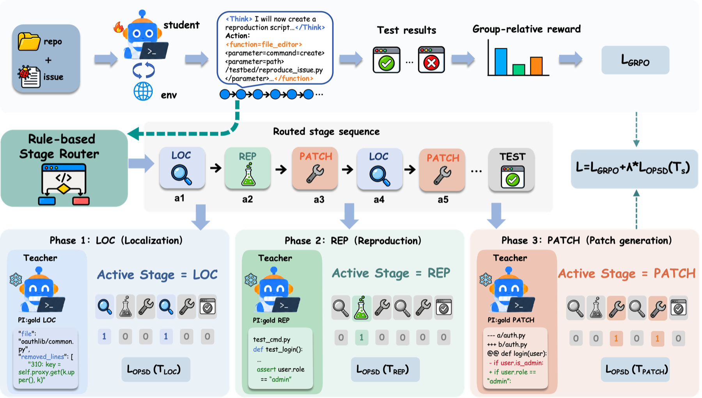
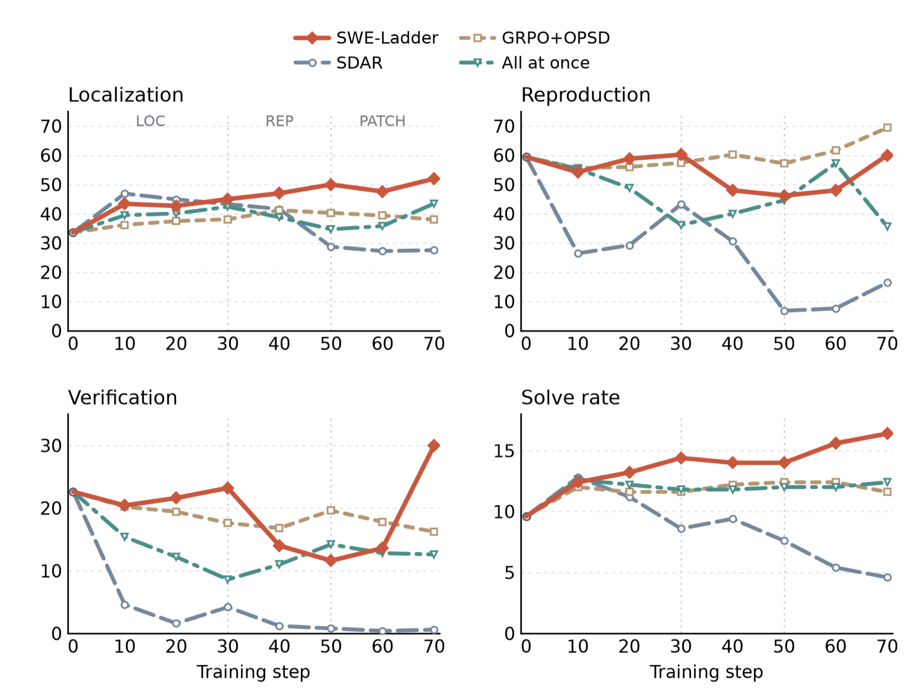

<div align="center">

# SWE-Ladder

**Learning to Localize, Reproduce, and Patch via<br/>Progressive Privileged Self-Distillation**

[](LICENSE)
[](pyproject.toml)

</div>

<p align="center">
  
</p>

<p align="center"><em>
A rule-based router labels each step of an end-to-end rollout as LOC, REP, or PATCH. In each phase, a frozen teacher receives only that stage's evidence and distills only that stage's tokens, while GRPO continues to optimize the full trajectory.
</em></p>

Resolving a repository-level issue requires a software-engineering agent to
localize the faulty code, reproduce the failure, and patch the code.
Reinforcement learning with verifiable rewards supplies one signal for the final
patch; on-policy self-distillation (OPSD) supplies denser token-level guidance,
but a teacher shown the full reference patch at every step gives the same
evidence at every stage. **SWE-Ladder** turns each verified repair into three
stage-specific evidence views and distills them in repair order, training a
single end-to-end agent without privileged evidence at inference time.

## News

- **Oct 2026** — Code released.

## Highlights

- **Stage-specific privilege instead of whole-answer privilege.** The teacher sees
  changed files and line ranges for localization, fail-to-pass tests for
  reproduction, and the reference diff for patching — never the whole answer at
  every step.
- **Progressive supervision in repair order.** Distillation moves
  `LOC → REP → PATCH` over 30 + 20 + 20 training iterations while GRPO keeps
  optimizing every valid response token.
- **A single inference-time policy.** No teacher, no stage labels, no fixed
  pipeline at test time.
- **+6.8 points on R2E-Gym and +4.6 points on OpenHands** on SWE-bench
  Verified, without task-specific supervised fine-tuning before RL.

## Results

Results from the paper. All methods start from Qwen3-4B-Instruct-2507 and are
evaluated on the 500 instances of SWE-bench Verified without task-specific
supervised fine-tuning before RL. `pass@1` is the official verifier result;
`env_done` is the fraction of rollouts that terminated on their own.

| Scaffold | Method | pass@1 (%) | Avg. steps | env_done (%) |
|---|---|---:|---:|---:|
| **R2E-Gym** | Qwen3-4B-Instruct-2507 (Base) | 9.6 | 26.5 | 84.2 |
| | GRPO | 10.4 | 82.9 | 36.0 |
| | GRPO+OPSD (full patch) | 12.4 | 39.7 | 67.4 |
| | SDAR | 4.6 | 34.5 | 88.0 |
| | **SWE-Ladder** | **16.4** | **19.3** | **98.6** |
| **OpenHands** | Qwen3-4B-Instruct-2507 (Base) | 13.0 | 40.8 | 79.2 |
| | GRPO | 11.2 | 56.2 | 78.6 |
| | GRPO+OPSD (full patch) | 12.4 | 15.4 | 99.0 |
| | SDAR | 6.8 | 37.4 | 92.8 |
| | **SWE-Ladder** | **17.6** | **16.6** | **99.4** |

GRPO+OPSD shows the teacher the full reference patch at every step. SDAR is a
gated OPSD method for agents, included with the same patch evidence.

**Ablations in the paper.** Removing LOC, REP, or PATCH lowers pass@1 from
16.4% to 11.2%, 13.2%, or 14.0%; training all three stages at once reaches 12.4%;
reversing the order reaches 11.4%; and a REP-first order reaches 12.6%. A
neural router agrees with annotator labels more often than the rule-based router
(98.63% vs. 92.0%) but trains a worse agent. The paper reports these and the
privilege-alignment ablations in full.

<p align="center">
  
</p>

<p align="center"><em>
Four-view training dynamics on SWE-bench Verified. Vertical guides mark the
LOC, REP, and PATCH phases of SWE-Ladder.
</em></p>

### Evaluation protocol

| Scaffold | Context | Max steps | Temperature | Instances |
|---|---:|---:|---:|---:|
| R2E-Gym | 64K | 150 | 0.7 | 500 |
| OpenHands | 128K | 150 | 0.7 | 500 |

All configurations are evaluated in the same environment and protocol within
each scaffold.

## Method

SWE-Ladder has three parts: stage-specific evidence, a deterministic router that
assigns it, and a progressive schedule that introduces one stage at a time.

### Stage-specific evidence

The verified repair and its tests are converted into three evidence views. The
student never sees any of them.

| Stage | Router sees | Teacher evidence | Distilled tokens |
|---|---|---|---|
| **LOC** | Search, file view, read-only shell | Changed non-test files, old-side hunk ranges, and pre-patch source lines | Response tokens labeled `LOC` during the LOC phase |
| **REP** | Repro script creation/execution, test file edits, test runs | Fail-to-pass test identifiers/names, reference test code, and candidate test changes | Response tokens labeled `REP` during the REP phase |
| **PATCH** | Source-file edits | The verified repair diff | Response tokens labeled `PATCH` during the PATCH phase |

Stage labels are annotations for distillation only. They do not constrain tool
choices, truncate rollouts, or change the reward.

### Progressive schedule

Training proceeds through the stages in repair order, with each phase resuming
the previous checkpoint:

| Phase | Privileged stage | Iterations | Checkpoint |
|---|---|---:|---|
| 1 | `causal_localization` | 30 | `global_step_30` |
| 2 | `localized_issue_reproduction` | 20 | `global_step_50` |
| 3 | `patch_generation` | 20 | `global_step_70` |

At each iteration, the router assigns every step a stage. Only tokens belonging
to the active stage receive the OPSD term; every valid response token still
receives the GRPO term. The teacher is a frozen copy of the base checkpoint, so
the privileged context is the only task information the student does not have
at training time. The full objective is

```text
L = L_GRPO + λ · L_OPSD,    λ = 0.15,    teacher top-K = 16
```

The OPSD term is a stop-gradient top-K reverse-KL surrogate on the teacher's
16 most likely tokens. All teacher variants share the student's system and task
instructions; only the appended evidence block differs. The 70-iteration total
matches the `baseline_grpo_4b_openhands.yaml` control: the two runs take the same
70 policy updates on the same data and differ only in where privilege is
applied. Each iteration samples 16 tasks with 4 rollouts per task (64
trajectories), and the entropy-bonus coefficient is 0.005. Training data
contains 1,149 issues: SWE-smith (500), SWE-ReBench (431), R2E-Gym (155), and
SWE-Gym (63).

### The stage router

The router is a deterministic tool-level state machine. It advances only forward
in the order `LOC → REP → PATCH`, with state-dependent backtracking: three
consecutive exploration actions in REP return to LOC; in PATCH, one test run
moves the state back to REP and one exploration action returns it to LOC. A
PATCH proposal from LOC can therefore skip REP. The router consumes only the
parsed tool call; malformed tool calls are handled explicitly.

The router is evaluated on held-out stage-labeled steps. The rule-based router
agrees with the reference labels on **92.0%** of steps. A neural router trained
on Qwen3.8-Max annotations reaches **98.63%** agreement on the same held-out
set, but yields lower downstream pass@1; annotation agreement alone does not
determine training utility.

| Router | Agreement with held-out labels |
|---|---:|
| Rule-based (SWE-Ladder) | 92.0% |
| Neural (Qwen3.8-Max annotations) | 98.63% |

SWE-Ladder uses the rule-based router; the neural router is an ablation.

## Quick start

```bash
git clone https://github.com/sekongger/SWE-Ladder
cd SWE-Ladder
```

See [`integration/README.md`](integration/README.md) for installation and
[`docs/TRAINING.md`](docs/TRAINING.md) for the smoke test and device setup.

## Repository layout

| Directory | Contents |
|---|---|
| [`swe_ladder/`](swe_ladder/) | The method: stage router, privileged-context builders, top-K distillation loss, prompt templates. Installs as `rllm.opd`, so `swe_ladder.X` here is `rllm.opd.X` once grafted. |
| [`training/`](training/configs/README.md) | 24 example run definitions (stage ladders, baselines, and ablations), launchers, and entrypoints. A config is the *whole* run definition. |
| [`eval/`](eval/README.md) | End-to-end SWE-bench Verified: serve a checkpoint, roll out, and recover from infrastructure failures until 500 clean rows exist. |
| [`stage_capability_eval/`](stage_capability_eval/README.md) | Per-stage scoring with oracle localization handed to the later stages, so a drop between stages is attributable. |
| [`analysis/`](analysis/README.md) | Six experiment groups with their shipped data. |
| [`scripts/`](scripts/data/README.md) | Dataset construction, config rendering, prompt-template generation, environment setup. |
| [`data/`](data/README.md) | Dataset recipe and staged-record samples. No datasets or weights. |
| [`integration/`](integration/README.md) | The three upstream patches, the installer, and the install checker. |
| [`docs/`](docs/) | [TRAINING.md](docs/TRAINING.md) — how a run is launched and which knobs are load-bearing. [EVALUATION.md](docs/EVALUATION.md) — evaluation protocols and notes. |
| [`assets/`](assets/) | Figures from the paper used in this README. |

## Analysis

The stage-level diagnostics are computed from the same 500 SWE-bench Verified
trajectories. Localization is gold-file recall, reproduction is creating and
running a failing reproduction, verification is re-running the reproduction
after the last edit without a failure, and solve is the official verifier
result. Additional offline analyses are in [`analysis/`](analysis/README.md).

## Scope

This repository contains the training and evaluation code, run configurations,
and analysis scripts. Datasets and weights are built or downloaded with the
recipes in [`data/README.md`](data/README.md). Run outputs are produced locally
and are not part of the release. The private evaluation split is generated
locally by `stage_capability_eval/` for scoring.

## Requirements

The standalone tooling (`scripts/`, `analysis/`, `stage_capability_eval/`,
`eval/`) runs on plain CPU Python ≥ 3.10:
`pip install -r requirements.txt`. It uses no accelerator
stack. The trainer's dependencies — torch or torch_npu, vLLM, verl, Ray — come
from the upstream rllm environment you install into; `scripts/setup/` has the
Ascend and CUDA environment builds we used.

The paper's 4B runs used 8× Ascend 910B. [`docs/TRAINING.md`](docs/TRAINING.md)
has the device-specific knobs.

## Citation

Citation information will be added once the paper is publicly available.

## License and attribution

Apache-2.0 ([LICENSE](LICENSE)). [NOTICE](NOTICE) records what is derived from
what: the patches and the generated prompt templates are derived works of
[SWE-Master](https://github.com/RUCAIBox/SWE-Master) (which vendors rllm and
R2E-Gym) and [verl](https://github.com/verl-project/verl); everything else is
ours.

Work this builds on, cited in the files that depend on them: SWE-Master
(arXiv:2602.03411), R2E-Gym (arXiv:2504.07164), OpenHands (arXiv:2407.16741),
ARPO (arXiv:2507.19849), SDAR (arXiv:2605.15155), and the fork-suppression
analysis replicated in `analysis/fork_suppression/` (arXiv:2607.05184).
